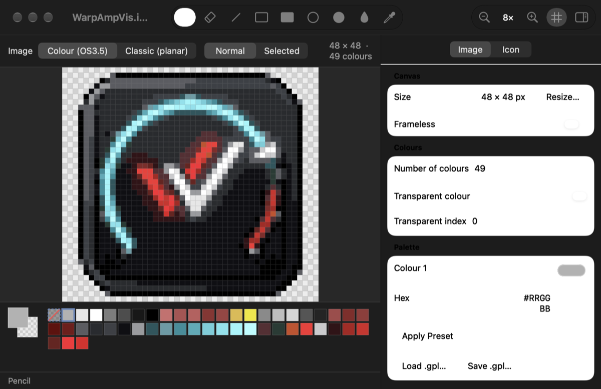

# AmIconEdit

A native macOS editor and Quick Look previewer for Amiga Workbench icons (`.info` files).



## Features

**Editing**
- Classic planar icons (Workbench 1.x–3.1, 1–8 bitplanes) and OS3.5 colour icons ("GlowIcons", up to 256×256 and 256 colours), normal and selected images.
- Pixel tools: pencil, eraser, line, rectangle, ellipse (outline and filled), flood fill and colour picker. Left click draws with the primary colour; right click or ⌥-click draws with the secondary colour. Hold ⇧ to constrain shapes.
- Flip, shift (wrap around), clear, canvas resize with an anchor, nearest-neighbour scaling, and zoom from 1× to 32× with a pixel grid.
- Palette: number of colours (2–256, or bitplane count for classic images), colour editing, transparent colour, Workbench palette presets (WB 1.3, WB 3.1, MagicWB…), and `.gpl` palette import and export. Reducing the number of colours remaps the pixels.
- **PNG/JPEG/TIFF import** with live preview:
  - fit, stretch, or resize the canvas to the picture;
  - generated optimal palette (median cut), the current palette, or a preset;
  - Floyd–Steinberg or ordered (Bayer 4×4 / 8×8) dithering;
  - alpha threshold for transparency.
- Generates the classic planar image from the colour image, for pre-OS3.5 Workbench.
- Icon attributes: type, stack size, position (or "no position"), default tool, tool types (add, remove, reorder), highlight mode, drawer window and view mode, and tool window.
- Full undo/redo. Exports the current image as PNG.

**Quick Look**
- Finder thumbnails, drawn pixel-sharp at integer scale.
- A space-bar preview that shows every image in the icon plus all Workbench attributes.

**File format support**

| Format | Read | Write |
|---|---|---|
| Classic `DiskObject` icons (OS 1.x–3.1) | ✔︎ | ✔︎ |
| OS3.5 `FORM ICON` (FACE/IMAG, RLE) | ✔︎ | ✔︎ |
| AROS `ARGB` chunks | preview | kept unchanged until the colour image is edited |
| OS4 / MorphOS PNG icons | preview | converted to OS3.5 when saved |

Unchanged icons are written back byte for byte, including unknown trailing data. The round trip has been tested on a collection of real-world icons.

## Requirements

- macOS 14 or later
- Xcode 16 or later to build

## Building

```sh
git clone https://github.com/andrzej79/AmIconEdit.git
cd AmIconEdit
open AmIconEdit.xcodeproj        # or:
xcodebuild -scheme AmIconEdit -configuration Release build
```

The project signs with "Sign to Run Locally" by default, so no Apple developer account is needed. To sign with your own team, copy `Config/Local.xcconfig.example` to `Config/Local.xcconfig` and set `DEVELOPMENT_TEAM`.

### Enabling Quick Look

The preview and thumbnail extensions are part of the app bundle. macOS picks them up after the app has been launched once, preferably from `/Applications`. If previews don't appear:

```sh
qlmanage -r && qlmanage -r cache          # reload Quick Look
pluginkit -m -v | grep AmIcon             # extensions should be listed
qlmanage -t -s 256 -o /tmp Some.info      # render a thumbnail from the command line
```

## Project structure

```
AmigaIconKit/        Framework shared by the app and the extensions
  Codec/             DiskObject, planar bitplanes, IFF, OS3.5 RLE, ARGB and PNG icon decoders
  Model/             AmigaIcon, DiskObjectInfo, images, palettes
  Imaging/           Quantiser (median cut), dithering, picture import, rendering
  Editing/           Pixel operations and icon-level editing operations
  Presets/           Workbench palettes, GIMP .gpl palettes
  Preview/           SwiftUI preview used by Quick Look
AmIconEdit/          SwiftUI document app (AppKit pixel canvas)
AmIconQuickLook/     Quick Look preview extension
AmIconThumbnail/     Quick Look thumbnail extension
Tests/               Swift Testing suites (codec, imaging, pixel ops, editor, preview) with real icon fixtures
```

Run the tests with:

```sh
xcodebuild test -scheme AmIconEdit
```

## Format notes

- The classic header is a `struct DiskObject` (magic `0xE310`). It is followed by optional drawer data, the bitplane images, the default tool, the tool types and the OS 2.x drawer extension.
- OS3.5 colour data is an IFF `FORM ICON` appended to the classic icon. `FACE` holds the size and flags. Each `IMAG` holds one image with an optional palette. Pixels are stored either uncompressed or with the bit-packed ByteRun1-style run-length encoding. A selected image may omit its palette and use the normal image's palette instead.
- Classic icons store no palette; their colours come from the Workbench screen. AmIconEdit shows them with a selectable Workbench palette preset.

## License

MIT, see [LICENSE](LICENSE). The test fixtures under `Tests/AmigaIconKitTests/Fixtures` are icons from the author's own Warp software.
